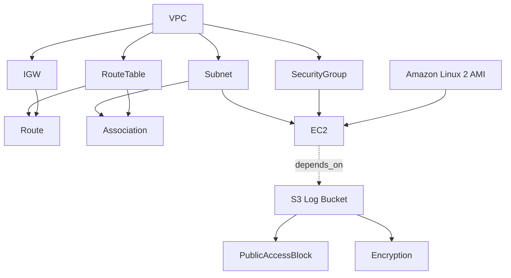

# Day 62 — Providers, Resources and Dependencies

## Objective

Build an AWS networking stack using Terraform and understand how providers, resources, implicit dependencies, explicit dependencies, and lifecycle rules work together.

## Project Structure

```text
2026/
└── day-62/
    ├── providers.tf
    ├── variables.tf
    ├── main.tf
    ├── outputs.tf
    ├── graph.png
    └── day-62-providers-resources.md
```

## 1. AWS Provider Configuration

### `providers.tf`

```hcl
terraform {
  required_providers {
    aws = {
      source  = "hashicorp/aws"
      version = "~> 5.0"
    }
  }

  required_version = ">= 1.5.0"
}

provider "aws" {
  region = var.aws_region
}
```

### `variables.tf`

```hcl
variable "aws_region" {
  type    = string
  default = "ap-south-1"
}

variable "my_ip_cidr" {
  description = "My public IP address in CIDR notation"
  type        = string
}

variable "log_bucket_name" {
  description = "Globally unique S3 bucket name"
  type        = string
}
```

### Provider version constraints

| Constraint | Meaning |
|---|---|
| `~> 5.0` | Allows versions `>= 5.0.0` and `< 6.0.0`. |
| `>= 5.0` | Allows version 5.0 and later, including future major versions. |
| `= 5.0.0` | Allows only version 5.0.0. |

The `.terraform.lock.hcl` file records the selected provider version and checksums. It helps ensure consistent provider installation across environments.

Initialize Terraform and inspect the installed version:

```bash
terraform init
terraform version
terraform providers
```

Record the actual AWS provider version reported by your environment.

## 2. AWS Networking Configuration

### `main.tf`

```hcl
# 1. Create a VPC
resource "aws_vpc" "main" {
  cidr_block           = "10.0.0.0/16"
  enable_dns_support   = true
  enable_dns_hostnames = true

  tags = {
    Name = "TerraWeek-VPC"
  }
}

# 2. Create a public subnet
resource "aws_subnet" "public" {
  vpc_id                  = aws_vpc.main.id
  cidr_block              = "10.0.1.0/24"
  map_public_ip_on_launch = true

  tags = {
    Name = "TerraWeek-Public-Subnet"
  }
}

# 3. Create an Internet Gateway
resource "aws_internet_gateway" "main" {
  vpc_id = aws_vpc.main.id

  tags = {
    Name = "TerraWeek-IGW"
  }
}

# 4. Create a route table
resource "aws_route_table" "public" {
  vpc_id = aws_vpc.main.id

  tags = {
    Name = "TerraWeek-Public-RT"
  }
}

# 5. Route internet traffic through the Internet Gateway
resource "aws_route" "internet_access" {
  route_table_id         = aws_route_table.public.id
  destination_cidr_block = "0.0.0.0/0"
  gateway_id             = aws_internet_gateway.main.id
}

# 6. Associate the route table with the subnet
resource "aws_route_table_association" "public" {
  subnet_id      = aws_subnet.public.id
  route_table_id = aws_route_table.public.id
}

# 7. Create a security group
resource "aws_security_group" "main" {
  name        = "TerraWeek-SG"
  description = "Security group for TerraWeek EC2"
  vpc_id      = aws_vpc.main.id

  ingress {
    description = "SSH from my IP only"
    from_port   = 22
    to_port     = 22
    protocol    = "tcp"
    cidr_blocks = [var.my_ip_cidr]
  }

  ingress {
    description = "HTTP access"
    from_port   = 80
    to_port     = 80
    protocol    = "tcp"
    cidr_blocks = ["0.0.0.0/0"]
  }

  egress {
    from_port   = 0
    to_port     = 0
    protocol    = "-1"
    cidr_blocks = ["0.0.0.0/0"]
  }

  tags = {
    Name = "TerraWeek-SG"
  }
}

# 8. Find an Amazon Linux 2 AMI in the selected region
data "aws_ami" "amazon_linux_2" {
  most_recent = true
  owners      = ["amazon"]

  filter {
    name   = "name"
    values = ["amzn2-ami-hvm-*-x86_64-gp2"]
  }

  filter {
    name   = "architecture"
    values = ["x86_64"]
  }
}

# 9. Create an EC2 instance
resource "aws_instance" "main" {
  ami                         = data.aws_ami.amazon_linux_2.id
  instance_type               = "t2.micro"
  subnet_id                   = aws_subnet.public.id
  vpc_security_group_ids      = [aws_security_group.main.id]
  associate_public_ip_address = true

  tags = {
    Name = "TerraWeek-Server"
  }

  lifecycle {
    create_before_destroy = true
  }
}

# 10. Create an S3 bucket for application logs
resource "aws_s3_bucket" "logs" {
  bucket = var.log_bucket_name

  # Create the bucket after the EC2 instance
  depends_on = [aws_instance.main]

  tags = {
    Name = "TerraWeek-App-Logs"
  }
}

# 11. Block public access to the bucket
resource "aws_s3_bucket_public_access_block" "logs" {
  bucket = aws_s3_bucket.logs.id

  block_public_acls       = true
  block_public_policy     = true
  ignore_public_acls      = true
  restrict_public_buckets = true
}

# 12. Enable default server-side encryption
resource "aws_s3_bucket_server_side_encryption_configuration" "logs" {
  bucket = aws_s3_bucket.logs.id

  rule {
    apply_server_side_encryption_by_default {
      sse_algorithm = "AES256"
    }
  }
}
```

**Note:** Provide a globally unique S3 bucket name and your public IP in CIDR notation, such as `x.x.x.x/32`. The Amazon Linux 2 AMI data source selects an image available in the configured region.

## 3. Implicit Dependencies

An implicit dependency occurs when one resource references another resource's attribute.

Example:

```hcl
vpc_id = aws_vpc.main.id
```

Terraform understands that the VPC must exist before it creates the subnet.

Dependencies in this configuration include:

- Subnet → VPC
- Internet Gateway → VPC
- Route table → VPC
- Internet route → Route table and Internet Gateway
- Route table association → Subnet and route table
- Security group → VPC
- EC2 instance → Subnet and security group
- S3 public access block → S3 bucket
- S3 encryption configuration → S3 bucket

Terraform uses these references to determine a valid execution order.

## 4. Explicit Dependencies

The S3 bucket uses:

```hcl
depends_on = [aws_instance.main]
```

This explicitly tells Terraform to create the EC2 instance before creating the bucket, even though the bucket does not reference an instance attribute.

### Real-world use cases

1. Ensure an IAM policy attachment exists before a dependent operation runs.
2. Ensure a prerequisite resource or configuration step completes before another resource is provisioned, when Terraform cannot infer the dependency from references.

Use `depends_on` only when necessary. Resource references are generally preferable because they express the relationship more directly.

## 5. Terraform Dependency Graph

Generate the graph:

```bash
terraform graph
```

To create a PNG image using Graphviz:

```bash
terraform graph | dot -Tpng -o graph.png
```

Simplified dependency diagram:



The actual Terraform graph may include additional internal nodes.

## 6. Lifecycle Rules

### `create_before_destroy`

```hcl
lifecycle {
  create_before_destroy = true
}
```

Creates a replacement resource before destroying the existing one when supported and feasible.

**Use case:** Reduce downtime during replacement of a server.

### `prevent_destroy`

```hcl
lifecycle {
  prevent_destroy = true
}
```

Prevents Terraform from planning destruction of a resource while this lifecycle rule remains in the configuration.

**Use case:** Protect critical resources from accidental deletion.

### `ignore_changes`

```hcl
lifecycle {
  ignore_changes = [tags]
}
```

Ignores changes to selected attributes when planning updates to existing resources.

**Use case:** Allow an external process to manage selected attributes.

Lifecycle rules should be used carefully because they can affect replacements, deletion protection, and drift detection.

## 7. Validation and Deployment

Run the following commands:

```bash
terraform fmt
terraform init
terraform validate
terraform plan
terraform apply
```

Review the plan before approving deployment.

Verify in the AWS console:

- VPC with CIDR `10.0.0.0/16`
- Public subnet with CIDR `10.0.1.0/24`
- Internet Gateway attached to the VPC
- Route table with a default route through the Internet Gateway
- Route table association with the subnet
- Security group with the intended ingress and egress rules
- EC2 instance with a public IP
- S3 bucket with public access blocked and encryption enabled

A public IP alone does not guarantee connectivity. Check routing, firewall rules, network ACLs, instance status, and application configuration.

## 8. Screenshots and Evidence

Add screenshots from your actual run before submitting:

- [ ] Successful `terraform apply` output
- [ ] AWS VPC console showing the networking resources
- [ ] EC2 console showing the instance state
- [ ] Dependency graph generated by `terraform graph`

Do not claim successful deployment until the resources have actually been created and verified.

## 9. Cleanup

After completing the exercise:

```bash
terraform destroy
```

Review the destruction plan before confirming. Terraform destroys dependent resources before their prerequisites.

Verify that the resources have been removed from the AWS console. Remember that AWS charges may apply while resources are running or for other billable usage.

## 10. Key Takeaways

- Providers connect Terraform to infrastructure platforms such as AWS.
- Version constraints control which provider releases are eligible for installation.
- The lock file records the selected provider version and checksums.
- Resource references create implicit dependencies.
- `depends_on` defines explicit dependencies when references are insufficient.
- Terraform builds a dependency graph to determine execution order.
- Lifecycle rules control resource replacement, destruction protection, and selected drift handling.
- `terraform destroy` removes managed resources according to their dependency relationships.

## Conclusion

Day 62 focused on building interconnected AWS infrastructure with Terraform and understanding how dependencies determine resource creation and destruction order.

The key lesson is that Terraform manages infrastructure as a dependency graph rather than simply executing resources from top to bottom.